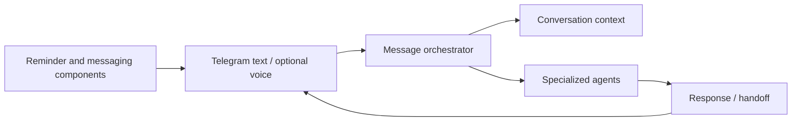

# Dementia Support Telegram Bot

**A multi-agent conversational assistant for caregiver-support workflows.**

The project implements an orchestrator that routes a Telegram conversation to
specialized agents while retaining context, scheduling reminders and optionally
supporting voice. Agent responsibilities, conversation state, scheduled messaging
and transport/provider integration are kept visible as distinct components.

## Implemented components

- An orchestrator for agent selection, conversation context and response handling.
- Specialized agent modules for memory prompts, routines, family support,
  wellbeing, general enquiries and related conversation topics.
- Conversation summarization and history access.
- Reminder and automated-message components.
- Optional speech-to-text/text-to-speech through Yandex SpeechKit.
- Local application and Docker service layouts for bot, agent, API and messaging roles.

The agent names describe routing roles. They do not establish medical expertise,
diagnostic accuracy or a validated emergency-response service.

## Architecture



Key source entry points:

- [Application startup](src/main.py)
- [Orchestrator](src/core/orchestrator.py)
- [Agent modules](src/agents)
- [Configuration loader](src/core/config.py)
- [Automatic messaging](README_auto_messaging.md)

## Local setup

Use Python 3.11+ and create a project environment:

```bash
git clone https://github.com/Maxi-online/dementia-support-bot.git
cd dementia-support-bot
python -m venv .venv
```

On Windows PowerShell:

```powershell
& .venv/Scripts/python.exe -m pip install -r requirements.txt
if (!(Test-Path -LiteralPath settings.json)) { Copy-Item -LiteralPath src/core/settings.json.example -Destination settings.json }
```

On Linux/macOS:

```bash
.venv/bin/python -m pip install -r requirements.txt
test -e settings.json || cp src/core/settings.json.example settings.json
```

For a fresh setup, edit `settings.json` with `telegram.bot_token` and
`openai.api_key`. Voice features additionally require the configured Yandex
settings. Keep existing credentials when adapting an established deployment;
the copy commands above initialize a fresh configuration.

Start the configured application with the environment's Python:

```powershell
& .venv/Scripts/python.exe -m src.main
```

The equivalent POSIX command is `.venv/bin/python -m src.main`.
[Docker deployment instructions](docker/README.md) describe the separate service
layout; a Compose layout alone is not evidence of a verified production deployment.

## Data and validation boundaries

Conversation history and reminder data can contain personal information. Keep
runtime configuration, databases, logs and dialog history outside published
examples. Use synthetic conversations for demonstrations.

The repository demonstrates routing, scheduling and messenger/provider
integration. Agent quality, difficult handoffs, reminder delivery and behaviour
during provider failures require separate end-to-end evaluation. No clinical
outcomes or medical-quality scores are claimed here.

## License

[MIT](LICENSE). Third-party APIs and libraries retain their own terms.

## Конфигурация, приватность и воспроизведение

Используйте `.env.example` и `src/core/settings.json.example` как схемы настройки; проверьте фактический порядок загрузки в `src/core/config.py`. Служебный скрипт миграции требует собственный пароль PostgreSQL. Медицинские диалоги, записи пользователей, резервные копии базы и TLS-ключи храните вне Git. Демонстрации проводите на синтетических данных.

Секреты храните в игнорируемых локальных файлах или переменных окружения. Безопасные примеры содержат только структуру настройки. Не передавайте секреты в командной строке и не добавляйте заполненные `.env`, приватные ключи, базы данных и логи в коммиты.

Workflow [Secret scan](.github/workflows/secret-scan.yml) проверяет текущие файлы и входящие коммиты Gitleaks 8.30.1 с редактированием значений в выводе. Это проверка на известные шаблоны, а не подтверждение отсутствия всех возможных утечек. Удаление значения из HEAD не очищает старую историю; порядок действий описан в [SECURITY.md](SECURITY.md).
